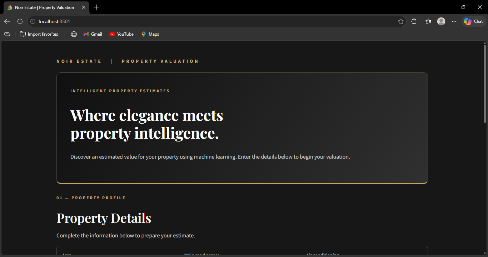
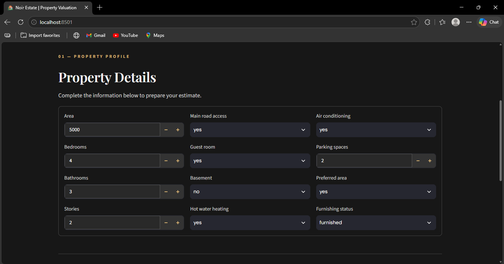
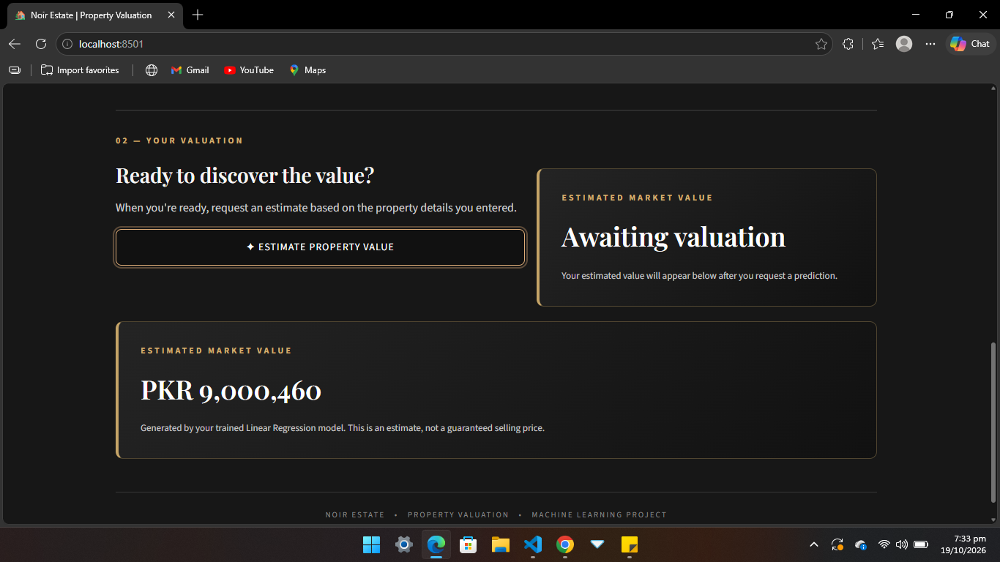
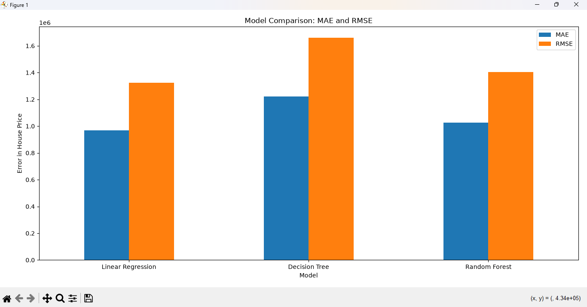
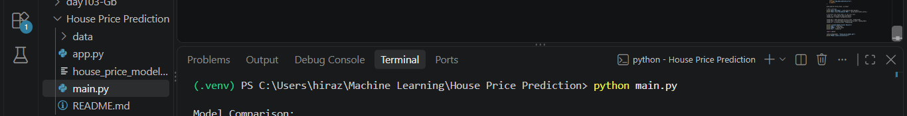

# 🏡 House Price Prediction Using Machine Learning

A machine learning project that predicts house prices based on property features, with an interactive Streamlit web application.

## 📌 Project Overview

This project includes data analysis, preprocessing, model training, evaluation, and an interactive web application called **Noir Estate | Property Valuation**.

## ✨ Features

- Exploratory data analysis and preprocessing
- Training and comparison of four regression models
- Evaluation using MAE, RMSE, and R²
- Saved model for predictions
- Interactive Streamlit web application

## 📊 Dataset

- **File:** `data/Housing.csv`
- **Records:** 545 rows
- **Columns:** 13, including the target variable `price`

## 🤖 Machine Learning Models

- Linear Regression
- Decision Tree Regressor
- Random Forest Regressor
- Tuned Random Forest Regressor

**Best-performing model:** Linear Regression, based on the test-set results.

## 📈 Model Evaluation

| Model | MAE | RMSE | R² |
|---|---:|---:|---:|
| Linear Regression | 970,043.4 | 1,324,507.0 | 0.653 |
| Decision Tree | 1,222,334.9 | 1,659,971.2 | 0.455 |
| Random Forest | 1,026,432.1 | 1,403,563.8 | 0.610 |
| Tuned Random Forest | 1,026,161.3 | 1,407,738.3 | 0.608 |

Linear Regression achieved the lowest MAE and RMSE and the highest R² among the models tested.

## 🖥️ Application Screenshots

### Home Page


### House Details


### Prediction Result


### Model Comparison


### Project Files


## 🛠️ Technologies Used

- Python
- Pandas and NumPy
- Scikit-learn
- Matplotlib and Seaborn
- Streamlit
- Joblib

## 🚀 How to Run the Project

### 1. Clone the repository

```bash
git clone https://github.com/HiraZulfiqar/house-price-prediction.git
cd house-price-prediction
```

### 2. Install dependencies

```bash
pip install -r requirements.txt
```

### 3. Run the application

```bash
python -m streamlit run app.py
```

Open the local URL shown in the terminal, usually `http://localhost:8501`.

## 📁 Project Structure

```text
House-Price-Prediction/
├── data/
│   └── Housing.csv
├── Screenshots/
│   ├── 01-Home-Page.png
│   ├── 02-House-Details.png
│   ├── 03-Prediction-Result.png
│   ├── 04-Model-Comparison.png
│   └── 05-Project-Files.png
├── app.py
├── main.py
├── house_price_model.pkl
├── requirements.txt
├── .gitignore
└── README.md
```

## 🔮 Future Improvements

- Experiment with additional regression algorithms
- Explore feature engineering and hyperparameter tuning
- Deploy the Streamlit application online

## 👩‍💻 Author

**Hira Zulfiqar**

[GitHub Profile](https://github.com/HiraZulfiqar)

---

*This project was developed as part of my machine learning learning journey, focusing on regression, model evaluation, and building an interactive ML application.*